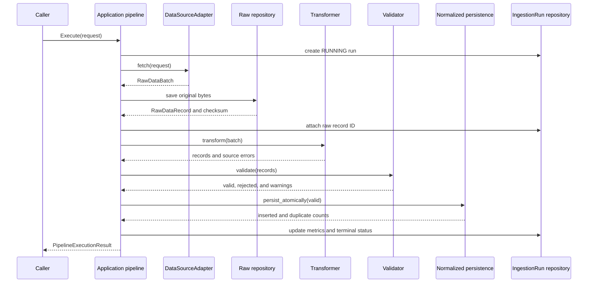

# Data Pipeline Specification

## Purpose and boundaries

The pipeline provides common interfaces for acquisition, transformation, validation, raw retention, normalized persistence, run tracking, and error reporting. `DataSourceAdapter`, `DataTransformer[T]`, `DataValidator[T]`, `RawDataRepository`, `IngestionRunRepository`, and `NormalizedDataPersistence[T]` are Application ports. Domain contains auditable `IngestionRun` and immutable `RawDataRecord`; SQLAlchemy and test adapters stay in Infrastructure. No live provider is included.

## Contracts and lifecycle

`DataFetchRequest` contains a source ID, non-empty dataset code, an immutable copy of scalar request parameters, and an aware UTC-normalized request timestamp. Credential-like parameter names are rejected. `RawDataBatch` retains exact non-empty `bytes`, media type, source availability/cursor/request ID, and fetched time. SHA-256 is calculated directly from the original bytes. Any media type is accepted. The default payload limit is 50 MiB and can be configured when constructing the use case.

Empty bytes fail acquisition with `EMPTY_PAYLOAD`; zero usable transformed records fail the run. Batch source and dataset identity must match the request. Raw data is saved before transformation, so later failures leave the original bytes available within the caller's transaction. Raw persistence never de-duplicates by checksum: each acquisition event gets a separate row.

## Validation, statuses, and errors

Transformation returns records, source-record count, transformed-record count, and typed issues with source locations. Validation returns valid records, rejected records with typed errors, warnings, and batch errors. Warnings alone do not reject records or make a run partial. Rejected records do not block valid records from persistence.

A run begins in `RUNNING` and ends in `SUCCEEDED`, `PARTIAL`, or `FAILED`; terminal runs are immutable. `fetched_count` is the number of source records reported by transformation. `transformed_count` is the number of emitted records. `accepted_count` is newly inserted normalized records. `rejected_count` is validation-rejected records. `duplicate_count` separately counts valid records already present under the normalized adapter's idempotency key. Transformation errors affect status and diagnostics but do not inflate `rejected_count` beyond transformed rows.

Failures are returned in `PipelineExecutionResult.errors` and stored as `error_code`/`error_message` on the run. They are not silently discarded. The use case does not commit caller-owned sessions. The caller owns commit/rollback for run and raw rows. The normalized persistence port guarantees that each `persist_atomically` operation is all-or-nothing; implementations should use the caller transaction or a savepoint and report counts only after success.

## Time and provenance

`source_available_at` means when the source made this acquired content available. `fetched_at` records when the adapter retrieved those bytes. Dataset records retain their own publication, availability, collection, and observation timestamps; pipeline timestamps never replace them. Request, batch, and run timestamps are aware and normalized to UTC. `requested_at` is the caller's request time, not a backtest availability timestamp. The pipeline never substitutes current time for source publication or dataset availability.

## Persistence and idempotency

Migration `0007_ingestion_pipeline` adds immutable raw-event records and lifecycle runs. Raw checksums are indexed but deliberately non-unique, so repeated identical payload fetches remain separately traceable. `IngestionRun.raw_data_record_id` links the successful raw save. Credentials and authorization headers are rejected from request metadata. Raw payloads have a configurable Application-level byte limit.

Normalized persistence is dataset-specific behind a typed generic port. Idempotency keys remain governed by each Domain's natural key: market observations retain source/revision keys, and financial statements retain source/period/revision keys. SHA-256 identifies bytes only; it is not a financial or market revision number and never replaces domain revision semantics.

## Integration procedure and transaction boundaries

A future adapter maps provider responses into `RawDataBatch` without exposing provider DTOs to Application or Domain. A dataset transformer parses its media type into the existing provider-neutral price, FX, or financial DTO/entity shape. A validator reuses that domain's validation rules. A dataset-specific normalized persistence adapter calls the existing repository using its natural keys. HTTP clients, CSV parsing, authentication, and provider cursors stay in Infrastructure. Market and financial repository contracts remain strongly typed and separate. The orchestrator does not commit; the caller owns the unit of work, and normalized persistence guarantees rollback for its atomic write operation.

## Current limitations

Only deterministic mock acquisition, transformation, validation, and normalized persistence adapters exist. Existing market-data and financial-data use cases are not routed through this orchestrator yet. Raw replay by record ID, background scheduling, parallel work, streaming/large-object storage, compression/retention policy, and production normalized adapters are not implemented. A source may omit its availability timestamp; dataset-specific code must still preserve its own point-in-time rules and never substitute `fetched_at`.
