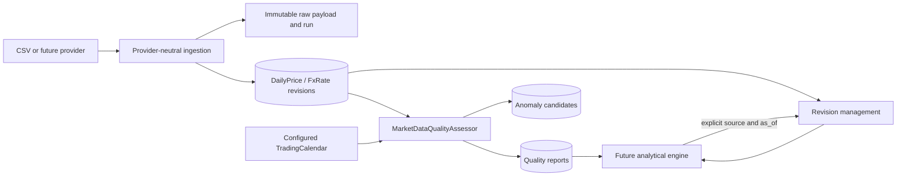

# Analytical Engine Data Contract

## Purpose

This document defines how future analytical engines may consume market observations after Sprint 07. It does not implement valuation, cycle analysis, screening, or backtesting.

## Data flow

## Consumption requirements

An engine must select a source deliberately and pass an explicit UTC-aware `as_of`. A market revision is eligible only when `available_at <= as_of`; `collected_at`, ingestion `fetched_at`, and the current system time are not substitutes. Existing revisions are immutable and selected deterministically by revision number among eligible rows.

An engine should inspect the corresponding quality report and open anomaly candidates for its security/pair and date range. `INSUFFICIENT_DATA` or `NOT_APPLICABLE` reports do not have a numeric quality score. A numeric quality score is separate from any future Value Score, Cycle Score, or Opportunity Score. Outliers are candidates for review and never mean that data was automatically corrected or proven erroneous.

## Current limitations

No analytical engine consumes quality reports yet. The weekday/holiday calendar is a configurable deterministic foundation, not a full exchange schedule. Price and FX outlier thresholds require market-specific calibration; corporate actions and venue changes can cause legitimate discontinuities. Financial statements are not part of this quality workflow.
