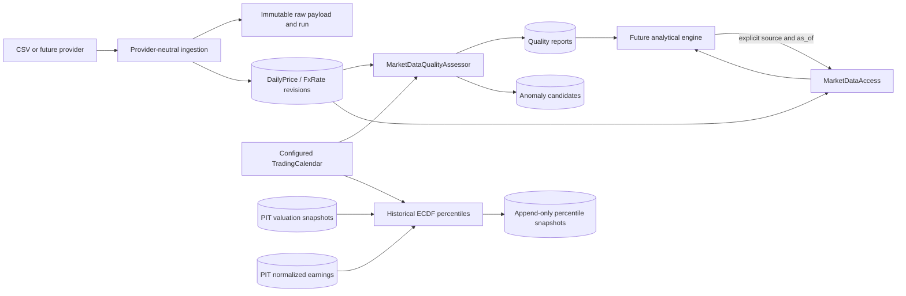

# Analytical Engine Data Contract

## Purpose

This document defines the current analytical data contracts and future engine boundaries. Sprint 09 adds historical valuation data calculations and Sprint 10 adds normalized historical earnings; neither implements Value Score, Cycle Score, screening, opportunity ranking, or backtesting.

## Data flow

## Consumption requirements

An engine must select a source deliberately and pass an explicit UTC-aware `as_of` to `MarketDataAccess`. Reads without an explicit source preserve separate records for each source; consumers must not treat those rows as a merged series. A market revision is eligible only when `available_at <= as_of` and the observation date is no later than the UTC date of `as_of`; `collected_at`, ingestion `fetched_at`, and current system time are not substitutes. Revisions are selected per source/date after availability filtering, highest eligible revision first, with deterministic timestamp and row-ID tie breaks. Revision history requires explicit source selection.

Period-read responses can also include retrieval status by source. `AVAILABLE`, `INSUFFICIENT_DATA`, and `NO_DATA` reflect only the number of eligible observations in the requested period relative to an explicit minimum; they are not source-health assertions. Latest observation details remain point-in-time filtered.

An engine should inspect the corresponding quality report and open anomaly candidates for its security/pair and date range. `INSUFFICIENT_DATA` or `NOT_APPLICABLE` reports do not have a numeric quality score. A numeric quality score is separate from any future Value Score, Cycle Score, or Opportunity Score. Outliers are candidates for review and never mean that data was automatically corrected or proven erroneous.

## Current limitations

No analytical engine consumes quality reports yet. The weekday/holiday calendar is a configurable deterministic foundation, not a full exchange schedule. Price and FX outlier thresholds require market-specific calibration; corporate actions and venue changes can cause legitimate discontinuities. SQL-backed point-in-time queries use window ranking and source/date indexes; large requested date ranges still naturally return all matching observations. Financial statements are not part of this quality workflow.

The valuation data foundation is defined in [VALUATION_SPEC.md](VALUATION_SPEC.md). It uses explicit PIT price and financial inputs and appends traceable metric snapshots. Sprint 11 adds historical ECDF percentile comparisons for PER, PBR, EV/EBITDA, normalized PER, and normalized EV/EBITDA; these are individual metrics, not composite scores. H1/9M cumulative statements, incompatible quarters, currency conversion, and incomplete TTM histories remain unavailable rather than being guessed or annualized.

Normalized historical earnings use only eligible annual FY statements from the explicit `as_of` view. Coverage/confidence and peak/trough candidates are analytical metadata, not a cycle-stage score. Normalized PER and EV/EBITDA reuse the existing valuation formulas; see [NORMALIZED_EARNINGS_SPEC.md](NORMALIZED_EARNINGS_SPEC.md).

Historical valuation percentiles consume the latest eligible Sprint 09 snapshot per trading date and metric. They use an exchange trading calendar for coverage, retain each source-specific series unless the request chooses source IDs, and compare only matching currency, unit, financial-period basis, and calculation version. Daily observations are retained (not silently resampled); persistence records excluded snapshot reasons and original snapshot links. Missing historical normalized results are rebuilt at each source snapshot's historical `as_of` using Sprint 10 and its existing PIT repository rules. See [HISTORICAL_VALUATION_PERCENTILE_SPEC.md](HISTORICAL_VALUATION_PERCENTILE_SPEC.md).
